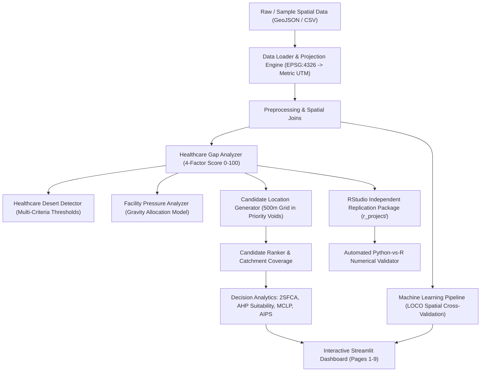

# CRADLE System Architecture & Technical Design

## 1. System Overview

**CRADLE (Critical Resource Allocation, Distribution & Location Engine)** is an urban healthcare spatial decision-support system designed to identify acute healthcare resource deficits and optimize facility allocations across Indian metropolitan cities.

CRADLE operates on a **Gap-First paradigm**: rather than beginning with land suitability, the engine diagnoses healthcare need and spatial isolation first, isolates high-deficit priority areas and healthcare deserts, generates candidate locations within deficit voids, ranks sites using multi-criteria coverage metrics, and solves integer programs for optimal multi-facility portfolios.



---

## 2. Multi-City Spatial Data & Projection Architecture

CRADLE supports analysis across multiple Indian states and municipal corporations without code modifications, managing spatial coordinate reference systems (CRS) dynamically:

| Metropolitan City | State | Municipal Authority | Administrative Units | Primary Focus Metric CRS | Central Meridian |
|---|---|---|---|---|---|
| **Chennai** | Tamil Nadu | Greater Chennai Corporation (GCC) | 200 Wards (15 Zones) | `EPSG:32644` (UTM Zone 44N) | 81°E |
| **Coimbatore** | Tamil Nadu | Coimbatore City Municipal Corp (CCMC) | 100 Wards (5 Zones) | `EPSG:32643` (UTM Zone 43N) | 75°E |
| **Bengaluru** | Karnataka | Bruhat Bengaluru Mahanagara Palike (BBMP) | 198 Wards (8 Zones) | `EPSG:32643` (UTM Zone 43N) | 75°E |
| **Hyderabad** | Telangana | Greater Hyderabad Municipal Corp (GHMC) | 150 Wards (6 Zones) | `EPSG:32644` (UTM Zone 44N) | 81°E |

### Spatial Coordinate Handling:
1. **Storage & Transmission Layer:** All vector datasets are stored in standard geographic coordinates (`EPSG:4326`, WGS84 latitude/longitude).
2. **Analysis & Calculation Layer:** Whenever geodesic distances, Euclidean point-in-polygon buffers, service catchments, or area calculations are executed, geometries are dynamically reprojected to the respective city's metric UTM zone (`EPSG:32644` or `EPSG:32643`).
3. **Composite Primary Keys:** To guarantee zero identifier collisions when pooling cross-city datasets in machine learning and benchmarking, all ward records use the standardized schema:
   $$\text{IND\_\{State\_Code\}\_\{City\_Code\}\_\{Administrative\_ID:03d\}}$$
   *(e.g., `IND_TN_CHN_001`, `IND_TN_COI_001`, `IND_KA_BEN_001`, `IND_TS_HYD_001`)*.

---

## 3. Modular Software Subsystems

### Subsystem 1: Core Spatial Analytics & Gap Engine (`src/`)
- `data_loader.py`: Ingests ward boundary polygons, population censuses, and healthcare facility vectors.
- `preprocessing.py`: Executes spatial intersections, point-in-polygon facility counts, hospital bed aggregations, and geodesic centroid distances.
- `gap_analyzer.py`: Formulates the 4-indicator Healthcare Gap Score ($0 - 100$), assigns planning priority tiers, and generates natural-language explainability summaries.
- `healthcare_desert.py`: Detects urban healthcare deserts where high population demand coincides with extreme bed deficits and travel distance thresholds.
- `facility_pressure.py`: Apportions ward populations to facilities using distance-decayed gravity allocation.
- `candidate_generator.py`: Generates spatial grid points ($500\text{m} \times 500\text{m}$) within high-priority wards, enforcing exclusion buffers around existing facilities.
- `candidate_ranking.py`: Evaluates candidates across gap severity, population catchment, and isolation.
- `coverage.py`: Calculates multi-radius ($2\text{km}, 3\text{km}, 5\text{km}$) population coverage gains.
- `scenario.py`: Simulates Before vs. After investment interventions and quantitatively measures gap score reduction.

### Subsystem 2: Advanced Phase 2 & 3 Decision Analytics
- `two_sfca.py`: Two-Step Floating Catchment Area (2SFCA) accessibility model with gravity, gaussian, and binary decay kernels.
- `ahp.py`: Analytic Hierarchy Process (AHP) evaluating physical site suitability (slope, road access, land use) separately from need.
- `mclp.py`: Maximal Covering Location Problem integer linear program solved via `PuLP` branch-and-bound.
- `sensitivity.py`: Multi-scenario sensitivity analysis evaluating rank volatility across competing policy regimes.
- `aips.py`: Adaptive Infrastructure Planning Score (AIPS) robustness index ($0 - 100$).
- `intervention.py`: Translates spatial gaps into concrete policy interventions (PHC, UPHC, CHC, General Hospital).

### Subsystem 3: Machine Learning Subsystem
- `model_training.py`: Extracts 10 spatial and demographic features across 648 wards, runs 4-fold **Leave-One-City-Out (LOCO) Spatial Cross-Validation**, trains Random Forest Classifier and Gradient Boosting Regressor, and serializes binaries to `models/`.
- `model_evaluation.py`: Generates confusion matrices, per-class classification metrics (Precision, Recall, F1), regression residuals (RMSE, MAE, $R^2$), and feature importances into `outputs/model_metrics/`.
- `model_inference.py`: Exposes high-performance inference APIs (`predict_ward()`, `predict_batch()`) and local feature contribution explainability.

### Subsystem 4: Independent RStudio Replication Package (`r_project/`)
- `CRADLE_R.Rproj`: Self-contained RStudio project.
- `scripts/01_load_data.R` through `06_validate_against_python.R`: Native R implementation utilizing the `sf` spatial ecosystem.
- `scripts/validate_r_output.py`: Automated cross-platform numerical validator verifying exact mathematical parity ($r = 1.000000$, $\text{MAE} = 0.0000$, $100\%$ concordance).

### Subsystem 5: Multi-City Interactive Dashboard (`app.py`, `pages/`)
- Built with **Streamlit**, **Folium**, **streamlit-folium**, and **Plotly**.
- Multi-city selector in sidebar with automatic session state persistence.
- 9 specialized operational pages:
  1. `1_Overview.py`: City infrastructure & cross-city comparative benchmarking.
  2. `2_Gap_Analyzer.py`: Ward-level gap choropleth & natural-language diagnostic.
  3. `3_Healthcare_Deserts.py`: Desert identification & facility gravity strain.
  4. `4_Candidate_Finder.py`: 500m candidate siting grid & recommendations.
  5. `5_Scenario_Simulator.py`: Before vs After policy intervention sandbox.
  6. `6_Accessibility.py`: 2SFCA spatial accessibility & road travel isochrones.
  7. `7_Optimization.py`: MCLP integer programming, budget scenarios, & AIPS robustness.
  8. `8_Machine_Learning.py`: Spatial LOCO CV metrics, confusion matrix, and interactive predictor.
  9. `9_Data_Quality.py`: Data provenance audit, missing values, and Python-vs-R validation.

---

## 4. Directory Layout

```text
CRADLE/
├── app.py                         # Multi-city Streamlit dashboard portal
├── config.py                      # Multi-city registry, UTM CRSs, thresholds
├── pytest.ini                     # Pytest path and runner configuration
├── requirements.txt               # Complete Python dependency specifications
├── ARCHITECTURE.md                # System technical design & architecture (this file)
├── METHODOLOGY.md                 # Gap-First and mathematical formulas
├── DATA_DICTIONARY.md             # Field specifications across all datasets
├── DATA_SOURCES.md                # Provenance and calibration documentation
├── TESTING_REPORT.md              # Test execution results & coverage report
├── PYTHON_R_VALIDATION.md         # Numerical comparison between Python and R
├── FINAL_REVIEW3_REPORT.md        # Comprehensive Review-3 final academic report
├── data/
│   ├── raw/                       # Raw municipal shapefiles / CSVs
│   ├── sample/                    # Calibrated multi-city datasets
│   └── processed/                 # Analysis-ready GeoJSONs (individual & combined)
├── models/                        # Serialized ML model binaries & preprocessors
├── outputs/
│   ├── maps/                      # Generated static & interactive maps
│   ├── reports/                   # Executive decision reports
│   ├── results/                   # Ranking CSV tables & MCLP outputs
│   └── model_metrics/             # Confusion matrices, feature importances, LOCO JSON
├── pages/                         # 9 Streamlit multi-page dashboard views
├── r_project/                     # Independent RStudio replication environment
├── scripts/                       # Headless execution, data generation, & validation
├── src/                           # 14 core analytics, ML, and optimization modules
└── tests/                         # Pytest test suite (17 comprehensive tests)
```
